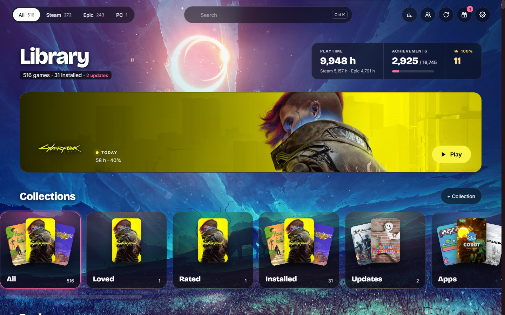
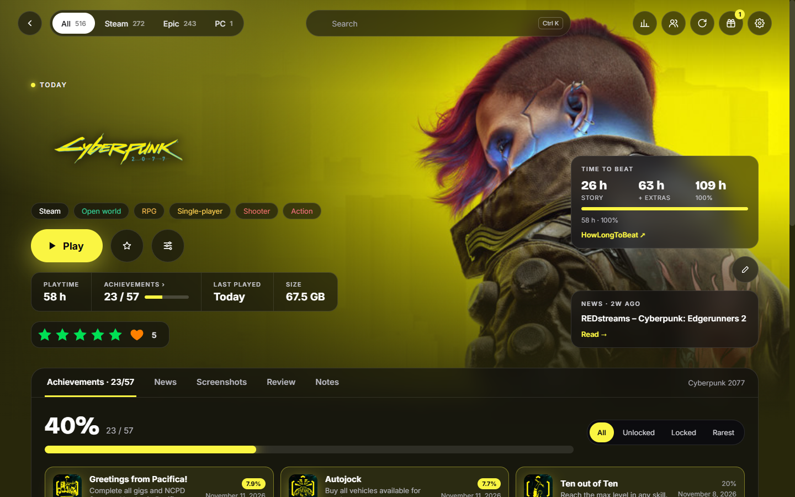
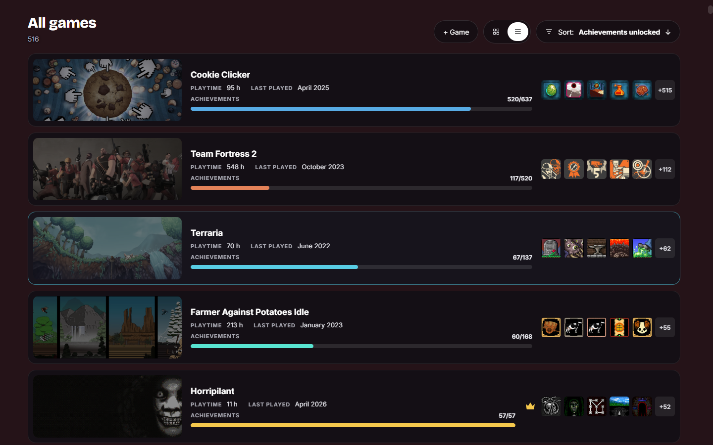
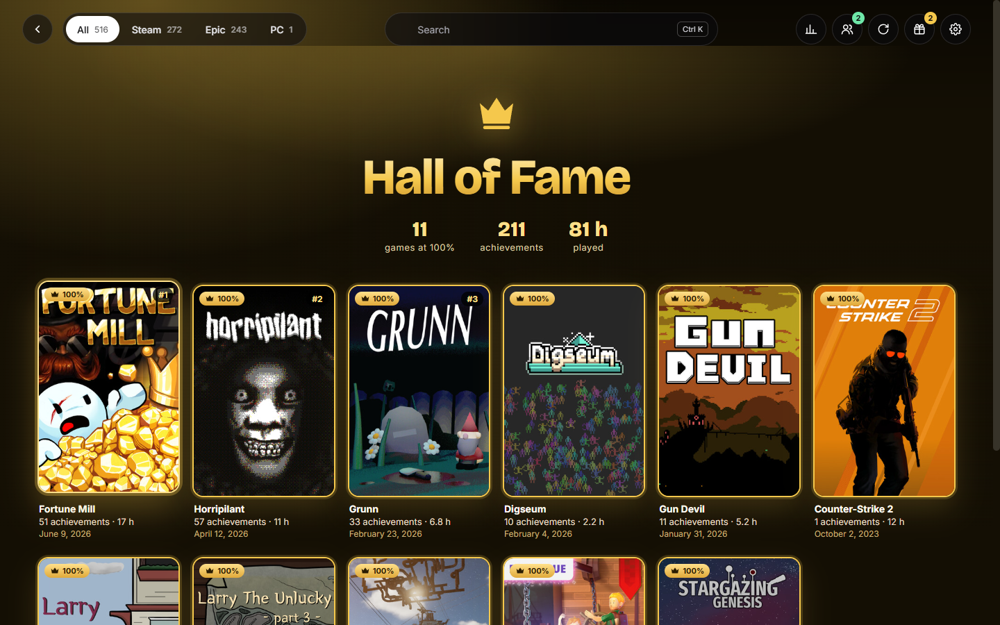

<div align="center">


# Ultimate

**One fast, beautiful library for all your PC games.**
Steam, Epic Games, GOG and any `.exe` — in one place.

[](https://github.com/Desarrh/ultimate/releases/latest)
[](https://github.com/Desarrh/ultimate/actions/workflows/ci.yml)
[](LICENSE)




</div>

## Download

Get **`Ultimate_x.y.z_x64-setup.exe`** from the [latest release](https://github.com/Desarrh/ultimate/releases/latest) and run it.
Updates install from inside the app in one click (signed packages).

## Features

- **Unified library** — installed and owned games from Steam, Epic Games and GOG, plus anything you add by `.exe` or shortcut.
- **Automatic collections** — Souls-like, Survival, Roguelite, Co-op… built from Steam user tags; add your own collections and favorites.
- **The colour follows the game** — the play button, bars and background take each game's dominant colour.
- **Achievements** — Steam and Epic, with rarity, unlock dates and a Steam-like list view when sorting by achievements.
- **Hall of Fame** — every game you finished at 100%, with its completion date.
- **Playtime everywhere** — Steam and Epic counters, plus Ultimate's own tracking for other games (even when launched outside the app).
- **Notes & ratings** — "where I'm at" notes per game, Letterboxd-style half-star ratings, favorites and reviews.
- **Time to beat** — HowLongToBeat story / extras / 100% durations next to your playtime.
- **News & patch notes** — official announcements only.
- **Free games & deals** — weekly freebies on Epic, Steam and GOG, discounts on your Steam wishlist, Windows notifications.
- **Steam friends** — who's online and what they play.
- **Save backups** — copies your save files using the community [Ludusavi manifest](https://github.com/mtkennerly/ludusavi-manifest).
- **Stats** — totals, top games, genres, platforms, daily history and streak.
- **Light on resources** — Rust core, artwork resized to the displayed size and cached, virtualised grid.
- **English & French**, controller mode, system tray, start with Windows.


<p align="center"><sub>Game page: the colour follows the game, achievements, time to beat, rating, news</sub></p>

<table>
<tr>
<td></td>
<td></td>
</tr>
<tr>
<td align="center">List view (sorted by achievements)</td>
<td align="center">Hall of Fame</td>
</tr>
</table>

## Connecting accounts (optional)

Everything installed is detected without any account. For more data, open **Settings**:

- **Steam** — paste a [Steam Web API key](https://steamcommunity.com/dev/apikey) (domain: `localhost`) and set *Game details* to public in your Steam privacy settings. Unlocks exact playtime, never-played games, achievements, friends and wishlist.
- **Epic Games** — sign in, then paste the `authorizationCode` shown by Epic. Unlocks Epic playtime and unlocked achievements.

Keys and tokens are stored in the **Windows Credential Manager**, never in plain files.

## Build from source

Requirements: Windows 10/11, [Rust](https://rustup.rs) (stable), [Node.js](https://nodejs.org) 20+, and the *Desktop development with C++* tools from Visual Studio Build Tools.

```bash
npm install
npm run tauri dev      # run with hot reload
npm run tauri build    # build the installer (src-tauri/target/release/bundle/nsis)
```

Tests:

```bash
npm test               # Rust unit tests
npm run audit          # checks the local library cache (duplicates, extras, missing data)
npm run test:ui        # end-to-end UI tests on a running app (see tests/ui.mjs)
```

## How it works

| Part | Where |
|---|---|
| Launcher detection (Steam VDF files, Epic manifests and catalog cache, GOG registry) | [`src-tauri/src/scan.rs`](src-tauri/src/scan.rs) |
| Metadata, artwork, colours, news, free games | [`src-tauri/src/meta.rs`](src-tauri/src/meta.rs), [`extra.rs`](src-tauri/src/extra.rs) |
| Accounts, achievements, Epic sign-in | [`src-tauri/src/accounts.rs`](src-tauri/src/accounts.rs) |
| Image resizing and cache (`img://` protocol) | [`src-tauri/src/img.rs`](src-tauri/src/img.rs) |
| Save backups | [`src-tauri/src/saves.rs`](src-tauri/src/saves.rs) |
| Interface | [`src/main.js`](src/main.js), [`src/style.css`](src/style.css), [`src/i18n.js`](src/i18n.js) |

Built with [Tauri 2](https://tauri.app). Games are launched through their own launcher (Steam, Epic) so DRM, overlays and cloud saves keep working.

## Disclaimer

Ultimate is an independent project, not affiliated with Valve, Epic Games, GOG, HowLongToBeat or any publisher. Game names, artwork and logos belong to their respective owners and are loaded from the stores at runtime.

## License

[GPL-3.0-or-later](LICENSE) © Desarrh
